# Wedding Invite — a personalized wedding invitation template

A digital wedding invitation that feels hand-delivered. Each guest gets their own link: it opens on a pair of studded Tunisian doors addressed to them by name, sealed with red wax. One tap cracks the seal, the doors swing open onto the couple's names, and the page scrolls from an ivory day into a gold-dusted night.

This branch (`main`) is the **template**: every name, date and place is a placeholder ("Name & Name", 14 October 2028, "Venue Name"). Fork it, fill in `site.config.ts`, and deploy.

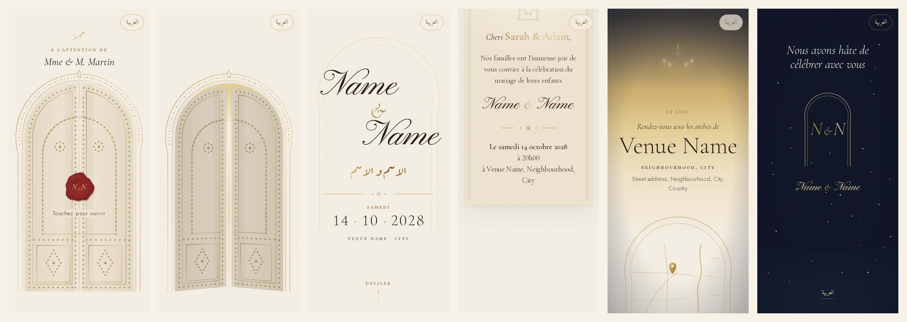

---

## Highlights

- **Personal, without a database.** The guest's details (salutation, one or two names, the line on the doors, language) are encoded in the link itself (`/i/<code>`). Nothing is stored and there's nothing to host except the site.
- **Server-rendered name and a personalized link preview.** WhatsApp, iMessage and others show a gold card reading *"Pour Mme & M. Martin"*.
- **A signature opening:** 3D doors, a wax seal that cracks, warm light, then the names written in by hand.
- **Day → night narrative:** ivory arches and hairline gold, a sunset horizon over the venue, then night with rising gold dust.
- **French and Arabic**, with full RTL, Arabic calligraphy (Aref Ruqaa) and Amiri text. The guest can switch at any time.
- **Link generator at `/admin`:** copy a link or send it straight to WhatsApp with a pre-written message, bulk-add guests, export CSV. Optional password.
- **Built for phones on mobile data:** mobile Lighthouse around 90 (French page), CLS 0, reduced-motion support, and particles only where the device can afford them.

| Doors | Opening | Names | Personal card |
|---|---|---|---|
| 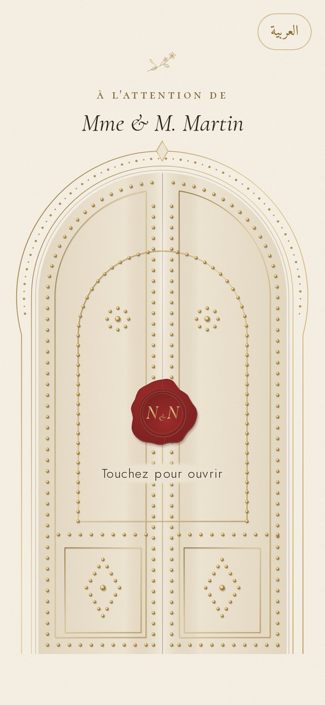 | 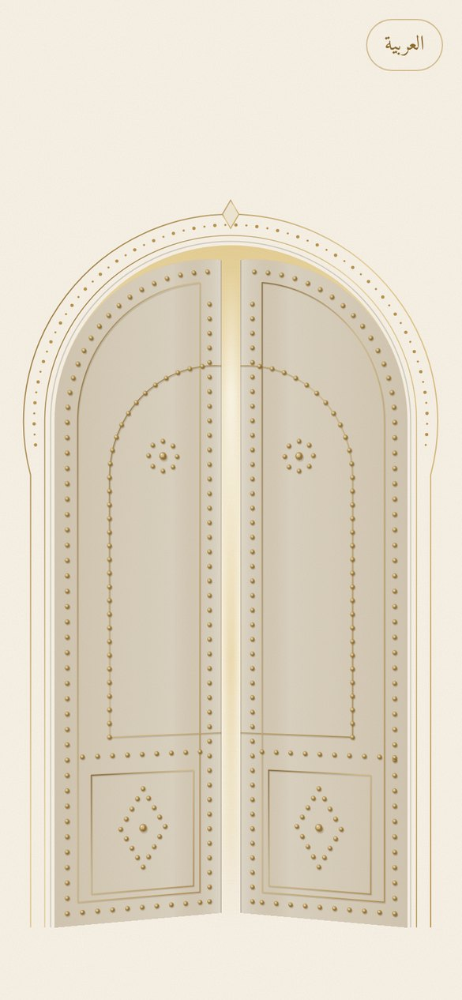 | 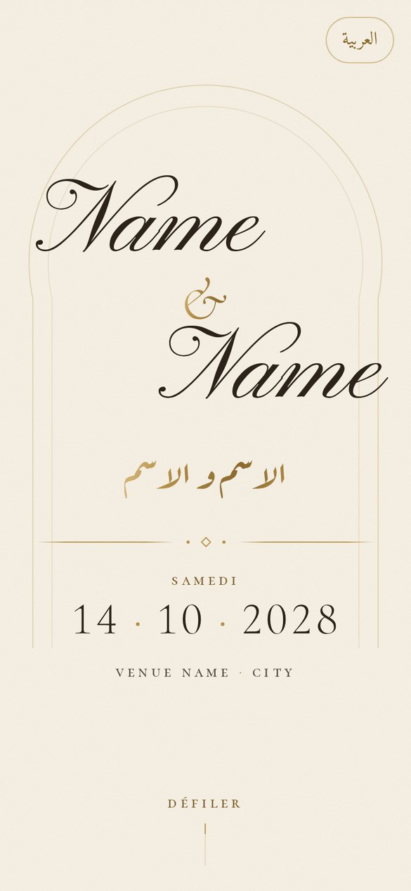 | 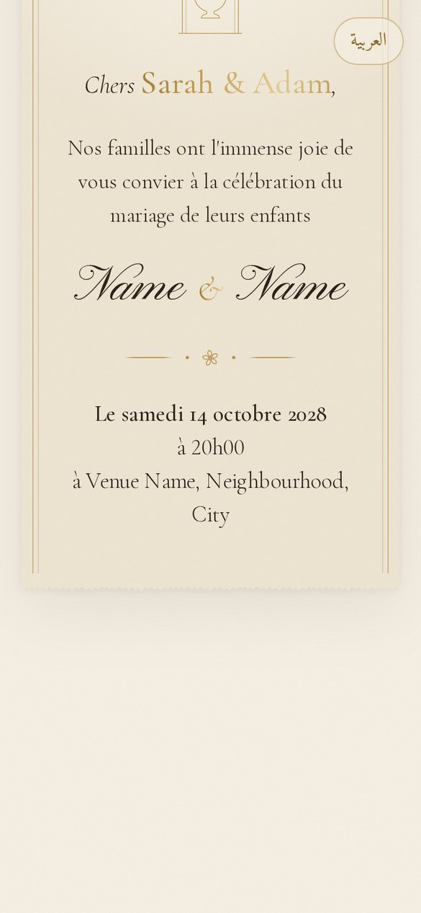 |

| Countdown | Programme | Dusk over the venue | Save the date |
|---|---|---|---|
| 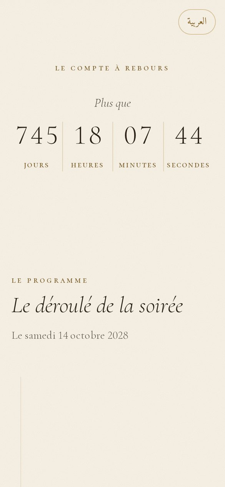 | 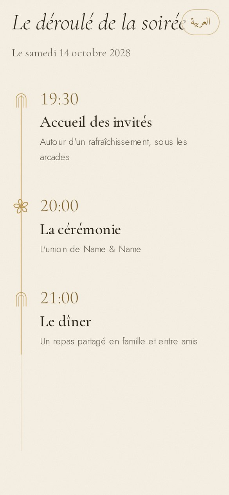 | 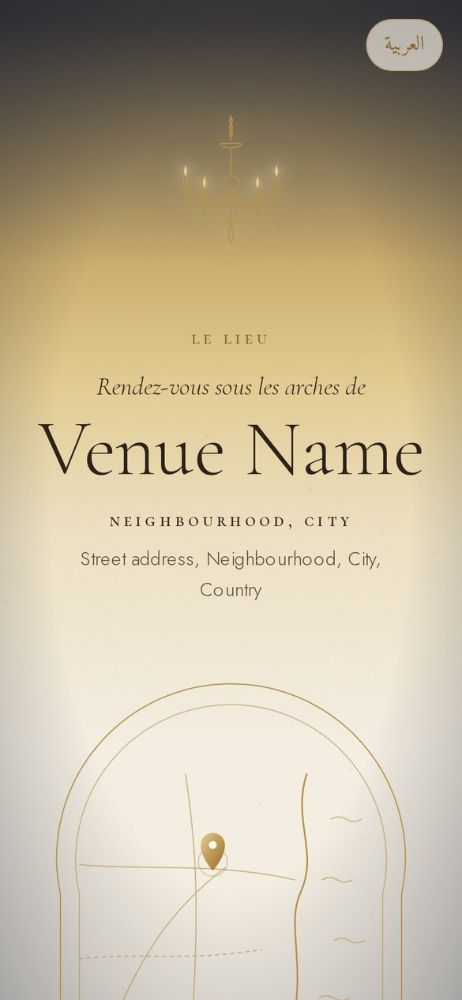 | 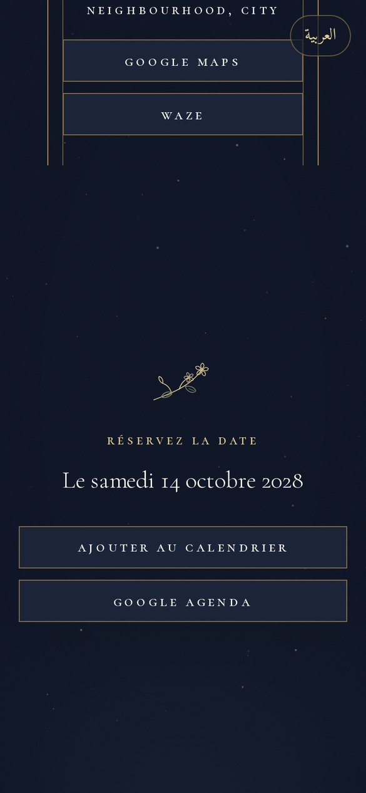 |

| Closing | Arabic doors | Arabic names |
|---|---|---|
| 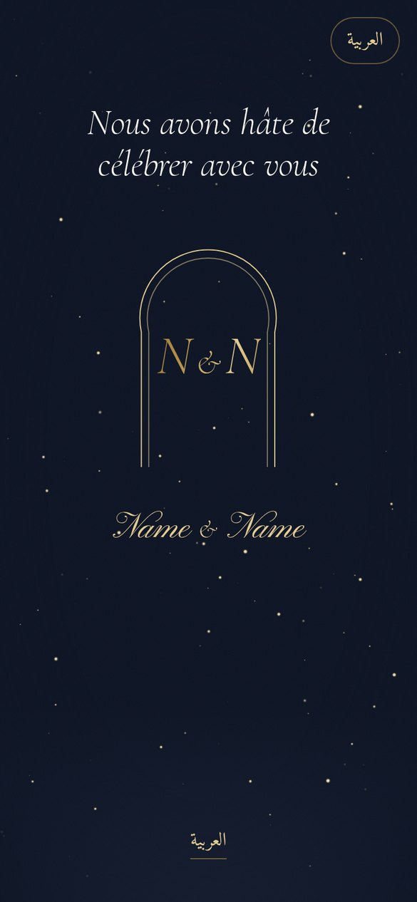 | 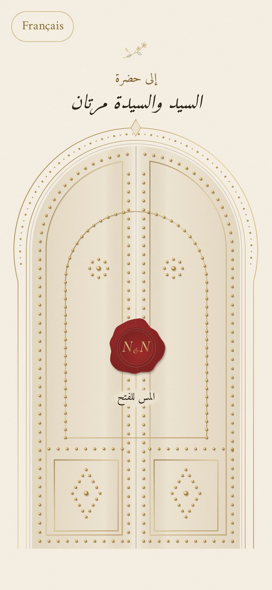 | 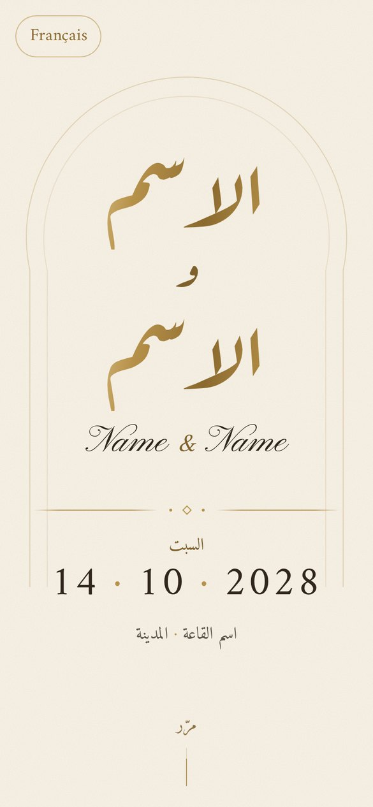 |

**Desktop**

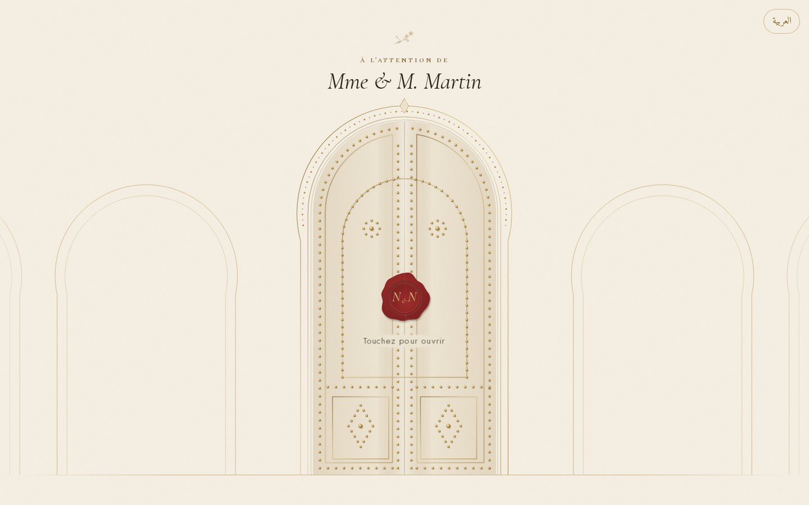
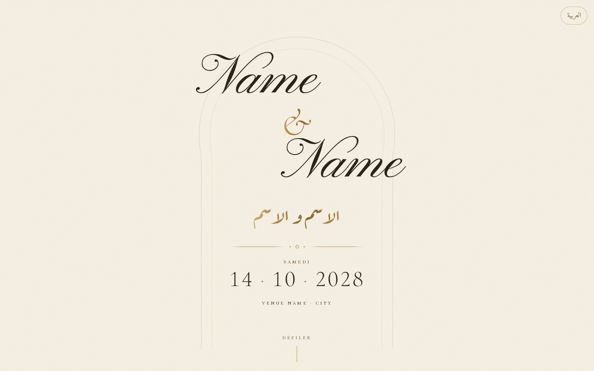

**Link preview** (generated per guest) and **link generator**

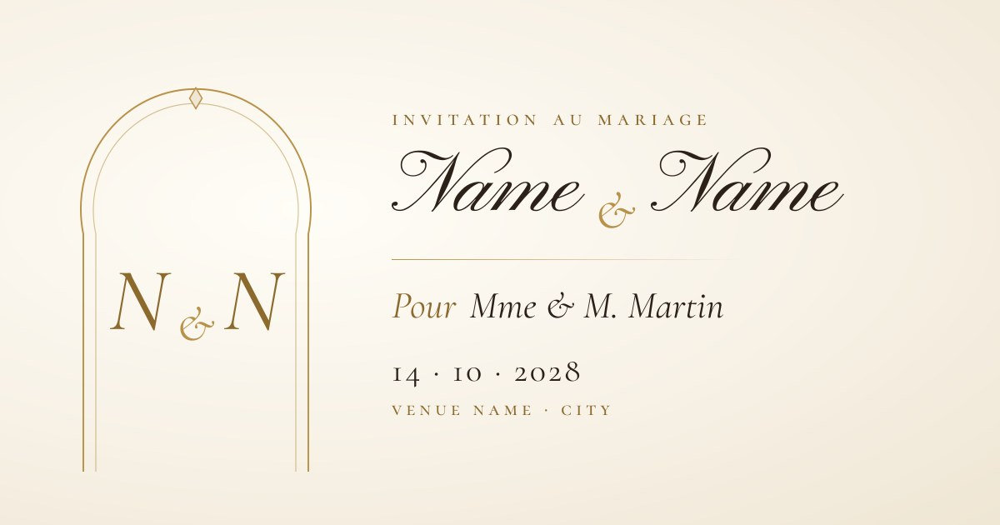
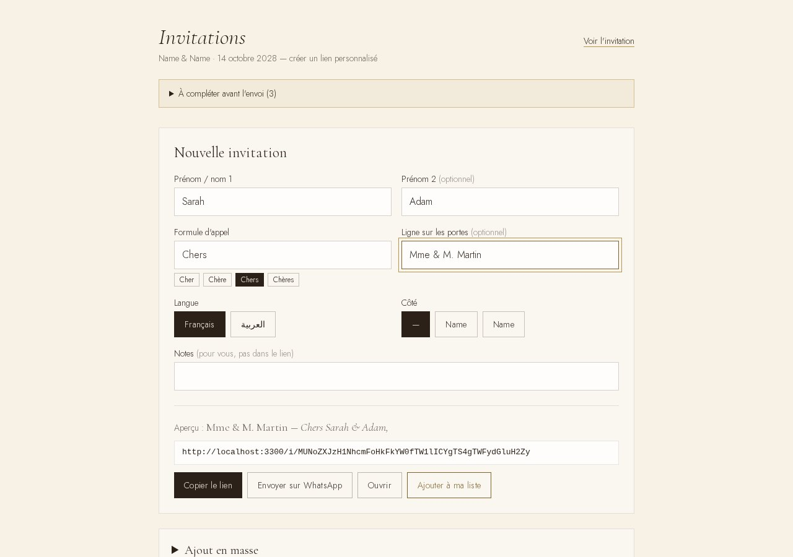

---

## Quick start

Requirements: Node 20+.

```bash
npm install
npm run dev          # http://localhost:3000
```

- Generic invitation ("À nos invités"): `/`
- Link generator: `/admin`
- A test invitation: `npm run code -- "Chers" "Sarah" "Adam" "Mme & M. Martin" fr`, then open `/i/<printed code>`

---

## Make it yours

### 1. Wedding facts: `site.config.ts`

Everything about the wedding lives in this one file. Components and copy read from it.

| Field | What to put |
|---|---|
| `couple.latin` | First names in Latin script (hero, card, previews, calendar) |
| `couple.arabic` | Same names in Arabic. **Then run** `scripts/subset-arabic.sh "<first> و <second>"` |
| `couple.monogram` | Letters on the wax seal, favicon and closing |
| `families.fr` / `families.ar` | Family names for *"Les familles X et Y ont l'immense joie…"* (leave `null` for *"Nos familles…"*) |
| `date.iso`, `date.time` | Local date `YYYY-MM-DD` and start time `HH:MM` (drives the countdown, card, calendar file) |
| `date.timezone`, `date.utcOffset` | Venue timezone and its UTC offset on that day, e.g. `Africa/Tunis` / `+01:00` |
| `date.durationHours` | Calendar event length |
| `venue.*` | Name, area, city, full address (FR and AR), Google Maps and Waze links |
| `programme` | Times for arrival, ceremony, dinner and celebration (`null` shows *"horaire à venir"*) |
| `photos` | Optional gallery; hidden while empty |
| `music.src` | Soft instrumental MP3 at `public/audio/theme.mp3`; the toggle hides itself if missing |

### 2. Wording: `content/fr.ts` and `content/ar.ts`

All sentences on the page, in both languages: door caption, invitation text, programme titles and descriptions, closing line, WhatsApp message. Names, dates and venue are inserted from the config automatically. Have the Arabic reviewed by a native speaker for your families.

### 3. Photos and music

- **Photos:** put files in `public/photos/` and list them:
  ```ts
  photos: [
    { src: "/photos/01.jpg", width: 1600, height: 2000, alt: { fr: "Les mariés", ar: "العروسان" } },
  ],
  ```
  They appear inside arch-shaped frames, served as AVIF/WebP by `next/image`.
- **Music:** `public/audio/theme.mp3` (128 kbps or less, loopable). It starts on the tap that opens the doors and fades in to volume 0.4.

### 4. Arabic fonts

French visitors download only a tiny subset of the Arabic fonts (for the "العربية" toggle and the couple's Arabic names), and Arabic visitors get trimmed faces. After changing `couple.arabic`, regenerate the subsets (requires `pip install fonttools brotli`):

```bash
scripts/subset-arabic.sh "سارة و آدم"
```

---

## How the links work

- `https://<domain>/i/<code>` is the link you send. `<code>` is URL-safe base64 of the guest fields (`lib/guest-code.ts`). The page is rendered on the server with the guest's name, and `/api/og/<code>` draws their preview image.
- `https://<domain>/#<code>` also works and redirects to `/i/<code>`, but the part after `#` never reaches the server, so those links get the generic preview.
- An unknown or damaged code shows the generic invitation with a discreet note to contact the family.
- Because nothing is stored, there is **no RSVP and no open tracking**. Add a form service of your choice if you need them.

## The link generator (`/admin`)

Type one or two names, choose the salutation (*Cher / Chère / Chers / Chères*, or the Arabic equivalents), the line on the doors, the language and the side, then:

- **Copier le lien** or **Envoyer sur WhatsApp** (a pre-written message in the guest's language)
- **Ajout en masse**: one guest per line, `Sarah & Adam ; Mme & M. Martin`
- **Liens créés sur cet appareil**: search, filter by side, delete, **Exporter en CSV** (the list lives in that browser's localStorage)

Set `ADMIN_PASSWORD` to protect it (httpOnly signed cookie, 60 days).

---

## Environment variables

| Variable | Purpose |
|---|---|
| `NEXT_PUBLIC_SITE_URL` | Your public URL, e.g. `https://sarah-et-adam.com`. Used for preview images and generated links. On Vercel it falls back to the production domain; `/admin` falls back to the browser origin. |
| `ADMIN_PASSWORD` | Optional. When set, `/admin` requires it. |

Copy `.env.example` to `.env.local` for local use.

## Deploy on Vercel

1. Push your fork to GitHub.
2. On vercel.com: **Add New → Project**, import the repository and keep the Next.js defaults.
3. Add `NEXT_PUBLIC_SITE_URL` and `ADMIN_PASSWORD` under **Settings → Environment Variables**, then deploy.
4. Add your domain under **Settings → Domains**, update `NEXT_PUBLIC_SITE_URL`, and redeploy.
5. Paste a `/i/<code>` link into WhatsApp to check the personalized preview. WhatsApp caches previews per URL, so finalize the design before sending.

Or from the CLI: `npx vercel --prod`.

---

## Tech

Next.js 16 (App Router, TypeScript) · Tailwind CSS 4 · GSAP 3 (ScrollTrigger, SplitText, DrawSVG) with `@gsap/react` · Lenis smooth scroll · OGL (gold dust) · `next/og` for previews · Playwright for checks.

```
site.config.ts             every wedding fact
content/fr.ts, ar.ts       all copy
app/
  page.tsx                 generic invitation + /#code redirect
  i/[code]/page.tsx        personalized invitation
  admin/                   link generator (+ optional login)
  api/og/[code]/route.tsx  personalized preview image
  api/ics/route.ts         calendar file
  doors.svg/route.ts       the door pair, prerendered as a static SVG
  icon.tsx                 favicon from the monogram
components/invitation/     Doors, Hero, InvitationCard, Countdown, Programme, Venue,
                           Gallery, Calendar, Closing, GoldDust, MusicToggle, LangToggle
components/ornaments/      hand-drawn SVG: doors, wax seal, arch, jasmine, Qallaline vase, chandelier
lib/                       guest codes, derived wedding values, motion tokens, GSAP loading, Arabic shaping for previews
scripts/                   screenshots, end-to-end checks, Arabic font subsetting
```

### Design system

- **Palette** (CSS variables in `app/globals.css`): ivory `#F7F1E6`, paper `#EFE6D4`, ink `#2B2118`, gold `#8C6A2E` / `#B8924A` / `#E6CF95`, sage `#7E8B6A`, night `#0E1526` / `#1A2338`, jasmine `#FFFDF7`. The only other colour is the wax red. Gold text is always a gradient, never a flat fill.
- **Type:** Pinyon Script (names), Cormorant Garamond (display), Cormorant SC (labels), Jost (body), Aref Ruqaa (Arabic names), Amiri (Arabic text). All OFL.
- **Motion:** tokens in `lib/motion.ts` (`power3.out` reveals, `expo.inOut` doors). Scroll animations are built only after the doors open, and the scroll plugins load on first interaction. `prefers-reduced-motion` gets fades instead of the swing, and no parallax, particles or split text.

### Checks

```bash
npm run lint && npm run typecheck && npm run build
npx next start -p 3200 &
BASE_URL=http://localhost:3200 ADMIN_PASSWORD=<same as server> npm run verify   # 42 end-to-end checks
BASE_URL=http://localhost:3200 npm run shots -- /i/<code> review --mid          # screenshots at 390×844 and 1440×900
```

The two audio checks need `public/audio/theme.mp3` to exist before the server starts.

---

## Credits and licences

- Fonts: Google Fonts, SIL Open Font License.
- GSAP and its plugins are free to use under the GSAP standard license (since 3.13).
- The ornaments (doors, seal, arches, jasmine, Qallaline vase, chandelier) are drawn in code in this repository.
